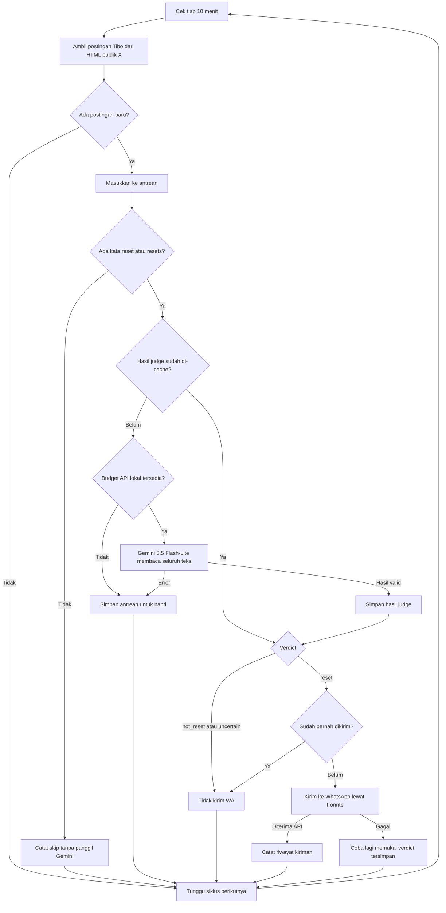

# Tibo Notif

Bot pemantau postingan **Tibo (@thsottiaux)** untuk mengirim info reset limit
Codex ke WhatsApp lewat Fonnte. Postingan diambil langsung dari HTML publik X;
tidak membutuhkan RSS.app atau token X API.

## Alur



Pesan notifikasi:

> Info reset codex brader!
>
> https://x.com/thsottiaux/status/POST_ID

Mention semua anggota grup **belum diaktifkan** karena parameter pendukungnya
belum ditemukan di dokumentasi Fonnte.

## Kebutuhan

- Linux dan Python 3.12+; hanya standard library, tanpa instal paket tambahan.
- API key Gemini dan device WhatsApp yang sudah terhubung ke Fonnte.
- Akses HTTPS ke `x.com`, `generativelanguage.googleapis.com`, dan `api.fonnte.com`.
- Pertahankan proxy dan CA trust bawaan jika dijalankan di Codex Cloud.

## Konfigurasi

Isi kredensial lewat environment settings atau environment proses. Jangan commit
API key, nomor tujuan, ID grup, atau database lokal ke repository.

| Variabel | Keterangan |
| --- | --- |
| `gemini_api_key` atau `GEMINI_API_KEY` | API key Gemini; salah satu wajib |
| `FONNTE_TOKEN` | Token device Fonnte; wajib untuk pengiriman |
| `WHATSAPP_TO` | Nomor internasional seperti `628…` atau ID grup seperti `120…@g.us` |
| `JUDGE_PROVIDER` | Default `gemini` |
| `JUDGE_MODEL` | Default `gemini-3.5-flash-lite` |
| `JUDGE_DAILY_MAX_CALLS` | Default `15` percobaan API per hari kalender Pacific |
| `JUDGE_RUN_MAX_CALLS` | Default `5`; monitor memproses maksimal satu kandidat per siklus |

Interval monitor adalah **600 detik** di `monitor_judge.py`.
`POLL_SECONDS` dan `SOURCE` dari bot lama tidak mengatur monitor ini.

## Menjalankan

Gunakan checkout yang sudah ada; tidak perlu membuat Git worktree baru.
Di cloud ini, direktori checkout adalah `/workspace/tibo-notif`.

```bash
cd /workspace/tibo-notif

# Tes lokal: API/pengiriman dalam tes memakai mock.
python -m unittest -q

# Baca postingan X saja, tanpa Gemini atau WhatsApp.
python scrape_x.py

# Satu siklus judge tanpa kirim WhatsApp; tetap dapat memakai kuota Gemini.
python monitor_judge.py --dry-run

# Satu siklus live: bisa mengirim WhatsApp jika verdict reset.
python monitor_judge.py

# Monitor live setiap 10 menit.
python -u monitor_judge.py --loop
```

Mode `--dry-run` tetap menyimpan antrean dan verdict. Verdict `reset` yang belum
terkirim bisa dikirim ketika mode live dijalankan kemudian.

Untuk menjalankan di background:

```bash
mkdir -p .local
nohup python -u monitor_judge.py --loop >> .local/monitor-judge.log 2>&1 &
echo $! > .local/monitor-judge.pid
```

Jalankan satu monitor saja. File lock mencegah dua proses monitor memakai state
yang sama. Hentikan proses bot lama sebelum menggantinya agar tidak ada dua pengirim.

## Melihat status

```bash
# Log terbaru atau pantau langsung (Ctrl+C hanya menghentikan tampilan log).
tail -n 20 .local/monitor-judge.log
tail -f .local/monitor-judge.log

# Cek PID dan command; pastikan ini proses monitor sebelum menghentikannya.
ps -p "$(cat .local/monitor-judge.pid)" -o pid,stat,etime,args
```

Proses yang ada belum membuktikan pengambilan data berhasil; periksa juga log
siklus terbaru. Pesan `No new posts to judge; no Gemini request` berarti tidak ada
kandidat baru yang perlu dinilai pada siklus itu.

## State dan penghematan kuota

- `.local/monitor-judge.sqlite3`: cursor, antrean postingan, verdict, dan riwayat
  notifikasi yang diterima API Fonnte.
- `.local/judge-experiment.sqlite3`: cache hasil Gemini dan penghitung percobaan
  API. Nama file ini dipertahankan agar riwayat budget tidak hilang.
- Pada startup pertama, hanya postingan terbaru yang masuk antrean. Berikutnya,
  postingan dengan ID lebih baru dimasukkan dan maksimal satu kandidat dinilai
  per siklus. Postingan tanpa kata `reset`/`resets` dilewati tanpa panggilan Gemini.
- Hasil di-cache berdasarkan teks, model, dan prompt. Request gagal juga dihitung
  dalam budget lokal. Budget habis atau 429 membuat pekerjaan tetap tertunda.
- Input lebih dari 4.000 karakter ditolak, bukan dipotong; output maksimal 256
  token. Permintaan berturut-turut dalam satu proses diberi jeda minimal 15 detik.
- Batas 15/hari adalah pengaman lokal, **bukan kuota resmi Gemini atau jaminan
  free tier cukup**. Aplikasi lain pada project yang sama juga memakai kuota.
- Pertahankan file database saat restart. Menghapusnya dapat menghilangkan
  deduplikasi dan penghitung budget.

Riwayat kiriman dari `.local/state.sqlite3`, jika ada dari versi lama, diimpor
untuk menghindari pengiriman ulang. File ini tidak dibutuhkan untuk instalasi baru.

## Batasan

- Parser membaca JSON yang sudah tertanam dalam HTML publik X tanpa mengeksekusi
  JavaScript atau memakai endpoint API tambahan. Hanya penulis Tibo yang diterima;
  kutipan bersarang tidak diperlakukan sebagai postingan tersendiri.
- Teks panjang diprioritaskan jika tersedia. Postingan yang membutuhkan ekspansi
  tetapi tidak menyertakan teks lengkap dilewati. Tidak mengambil teks gambar
  atau konteks thread tambahan.
- Tidak ada pagination atau jaminan seluruh reply tercakup. Postingan terlambat
  dengan ID di bawah cursor bisa terlewat. Perubahan HTML atau pembatasan akses X
  bisa menghentikan pengambilan; hasil kosong yang tak dikenali dianggap error.
- Filter awal bisa melewatkan pengumuman yang hanya memakai sinonim atau gambar.
  Verdict LLM juga bisa salah dan tidak membuktikan limit akun penerima sudah reset.
- Kegagalan kirim dicoba lagi tanpa mengulang judge. Crash atau timeout setelah
  Fonnte menerima pesan tetapi sebelum pencatatan lokal bisa menyebabkan duplikat.
  Penerimaan API tidak membuktikan pesan sampai ke perangkat penerima.
- Codex Cloud tidak menjamin layanan 24/7. Proses bisa berhenti saat environment
  ditangguhkan; startup ulang diperlukan setelah pemulihan.

## Struktur kode

| File | Fungsi |
| --- | --- |
| `monitor_judge.py` | Entry point monitor, antrean, filter awal, dan pengiriman bersyarat |
| `scrape_x.py` | Pengambilan dan parsing HTML publik X |
| `llm_judge.py` | Gemini judge, validasi hasil, cache, dan budget |
| `bot.py` | Menyediakan adapter Fonnte yang dipakai monitor; masih memuat kode versi lama |
| `test_*.py` | Tes parser, judge, budget, antrean, dan pengiriman dengan mock |

Saat perubahan dokumentasi ini, 32 tes lokal telah lulus. Pengambilan postingan
langsung dari X dan satu verdict Gemini telah diverifikasi live; angka itu bukan
jaminan cakupan timeline atau akurasi seluruh hasil judge.
